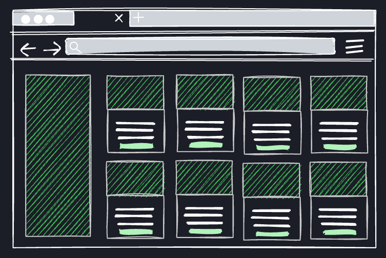

# Agente Aluguel

Um agente que procura **casas para alugar** por você. Você descreve o que quer (região, tipo, faixa de preço, quartos) numa sidebar, clica em **Buscar com o agente**, e ele varre portais de imóveis, descarta o que não bate com o pedido, guarda o resto num banco local e mostra tudo em cards ordenáveis.

> **Status: projeto em desenvolvimento, em fase de testes.** Hoje ele só busca no **Distrito Federal (DF)**. Leia [Limitações conhecidas](#limitações-conhecidas) antes de testar.



## Sumário

- [Como funciona](#como-funciona)
- [Pré-requisitos](#pré-requisitos)
- [Instalação](#instalação)
- [Executando](#executando)
- [Usando](#usando)
- [Análise com Claude (opcional)](#análise-com-claude-opcional)
- [Limitações conhecidas](#limitações-conhecidas)
- [Solução de problemas](#solução-de-problemas)
- [Aviso sobre scraping](#aviso-sobre-scraping)
- [Estrutura do projeto](#estrutura-do-projeto)
- [API, banco e scripts](#api-banco-e-scripts)
- [Desenvolvimento](#desenvolvimento)

## Como funciona

```
 Sidebar (front) ──► POST /agent/runs ──► API (Hono) ──► agente em segundo plano
                                                              │
        1. COLETA     OLX + DFimóveis  ──► navegador real (Ego Lite)
                      QuintoAndar      ──► HTTP direto
        2. FILTRO     preço, quartos, banheiros, tipo (regras)
        3. ANÁLISE    Claude confere cada anúncio (opcional; sem chave, usa regras)
        4. GRAVAÇÃO   SQLite (upsert pela URL do anúncio)
                                                              │
 Cards ordenáveis (front) ◄── GET /listings?sort=… ◄──────────┘
```

| Fonte | Como é lida | Traz data de publicação? |
| --- | --- | --- |
| OLX | navegador real (o site bloqueia HTTP direto) | sim |
| DFimóveis | navegador real | sim (só o dia) |
| QuintoAndar | HTTP direto, lendo os dados embutidos na página | **não** |

Cada busca leva **de 2 a 3 minutos** nos testes, e cresce com o número de regiões. O front mostra a etapa atual enquanto roda e, ao terminar, um resumo (clique em "detalhes" para ver quantos anúncios vieram de cada fonte e se algo falhou).

## Pré-requisitos

| Requisito | Versão / detalhe | Para quê |
| --- | --- | --- |
| **Node.js** | **22 ou superior** (testado com 24). O `better-sqlite3` exige Node ≥ 22. | API e front |
| **npm** | 10+ (testado com 11.19) | Gerenciar as dependências (workspaces) |
| **Git** | qualquer versão recente | Clonar o repositório |
| **Ego Lite** | app + comando `ego-browser` ([lite.ego.app](https://lite.ego.app/)) — macOS ou Windows | Navegador que o agente usa para ler OLX e DFimóveis |
| Compilador (Python 3 + C++) | **normalmente desnecessário**: o `better-sqlite3` já traz binários prontos para macOS, Linux e Windows (arm64 e x64). Só precisa de compilador em plataformas sem binário pronto. | — |
| **Chave da API da Anthropic** | *opcional* — [console.anthropic.com](https://console.anthropic.com) | Análise dos anúncios com Claude |

**Não é preciso ter o Claude Code nem nenhuma versão específica do Claude instalada.** O projeto só usa a *API* da Anthropic, e só se você colocar uma chave. Sem chave, tudo funciona com a validação por regras. Detalhes em [Análise com Claude](#análise-com-claude-opcional).

> **Testado apenas em macOS.** Windows deve funcionar, mas não foi testado. Linux depende do Ego Lite, que não documenta suporte.

### Instalando o Ego Lite

1. **macOS ou Windows:** baixe e instale em [lite.ego.app](https://lite.ego.app/) e abra o app.
2. Conclua o *onboarding* dentro do app. É ele que registra o comando `ego-browser` no seu `PATH` (normalmente em `~/.local/bin`).
3. Abra um **terminal novo** e confirme:

   ```bash
   ego-browser nodejs <<'EOF'
   console.log('ego-browser ready')
   EOF
   ```

   (No PowerShell/cmd, que não têm heredoc: `ego-browser nodejs -e "console.log('ego-browser ready')"`.)

   Deve imprimir `ego-browser ready`.
4. Se o terminal disser que `ego-browser` não existe, adicione `~/.local/bin` ao `PATH` (`export PATH="$HOME/.local/bin:$PATH"`) ou aponte o caminho em `EGO_BROWSER_BIN` no `api/.env`.
5. **Dica:** se o Ego Lite abrir um pedido de permissão (por exemplo, notificações) durante uma busca, clique em **Bloquear**. Quem decide permissões é você, e o agente para a coleta no navegador quando isso acontece (veja a [solução de problemas](#solução-de-problemas)).

## Instalação

```bash
# 1. Baixe o projeto
git clone <URL-DO-REPOSITORIO> agente_aluguel
cd agente_aluguel

# 2. Instale as dependências da API e do front (workspaces do npm)
npm install

# 3. Crie os arquivos de configuração
cp api/.env.example api/.env
cp front/.env.example front/.env.local

# 4. Crie o banco (SQLite local, em api/data/agente.db) e o perfil de busca inicial
npm run db:migrate
npm run db:seed
```

> O `npm install` pode avisar sobre *install scripts* bloqueados. O `package.json` já define o que autorizar em `allowScripts` (`esbuild`, `unrs-resolver`, `fsevents`). Se o seu npm ainda reclamar, rode `npm install-scripts approve esbuild unrs-resolver fsevents`. **Não autorize o `better-sqlite3`:** ele não precisa de script (o binário já vem pronto), e autorizá-lo faz o npm tentar compilar do zero e falhar sem Python.

Os valores padrão dos `.env` já funcionam em uma máquina local. A única variável que você talvez queira preencher é `ANTHROPIC_API_KEY` (veja [Análise com Claude](#análise-com-claude-opcional)).

## Executando

Abra **dois terminais** na pasta do projeto:

```bash
# terminal 1 — API (http://localhost:3333)
npm run dev:api

# terminal 2 — front (http://localhost:3000)
npm run dev:front
```

(No macOS/Linux, `npm run dev` sobe os dois de uma vez. No Windows, use os dois terminais.)

Abra **http://localhost:3000**. Antes de buscar, deixe o **Ego Lite aberto**.

Para parar, use `Ctrl+C` em cada terminal. Se você parar a API no meio de uma busca, ela é marcada como interrompida na próxima inicialização, e você pode rodar de novo.

## Usando

1. Na sidebar, ajuste os filtros. Eles seguem o padrão da OLX:
   - **Região:** adicione ou remova regiões (o campo sugere as regiões administrativas do DF; Enter adiciona).
   - **Tipo do imóvel** e **Subtipo** (casa de condomínio, kitnet, cobertura…).
   - **Preço:** mínimo e máximo, com a opção de incluir o condomínio na conta. A "média desejada" e a porcentagem da renda comprometida são calculadas para você (opcional).
   - **Quartos e banheiros:** 0 a 5+, com seleção múltipla.
2. Clique em **Buscar com o agente**. Os filtros são salvos e a busca começa.
3. Quando terminar, o front abre a aba **Última busca**, só com o que essa busca aprovou. A aba **Todos os resultados** mostra tudo que já foi salvo, de todas as buscas. Nela, filtre por **região** (Guará, Vicente Pires…); dá para marcar mais de uma, e sem nenhuma marcada aparecem todas. Ordene com os botões do topo: **Mais recentes**, **Maior % match**, **Maior preço**, **Menor preço**. A escolha fica na URL (`?sort=…`).
4. Cada card mostra a fonte, o match, a região, a data de publicação (quando a fonte informa), os cômodos, o preço total e, com Claude ativo, o motivo da aprovação. Clicar abre o anúncio original.

Rodar a busca de novo **atualiza** os imóveis já conhecidos (pela URL) em vez de duplicá-los.

## Análise com Claude (opcional)

Depois de coletar e filtrar por regras (preço, quartos, banheiros, tipo), o agente pode pedir ao Claude que confira cada anúncio. O Claude decide se o imóvel realmente atende ao perfil (por exemplo, entende que "QNL" é Taguatinga Norte e que "próximo a Taguatinga" **não** é Taguatinga), dá uma nota de 0 a 100 e escreve uma frase explicando a decisão.

**Para ativar:** coloque a chave em `api/.env` e reinicie a API.

```env
ANTHROPIC_API_KEY=sk-ant-...
```

- **Sem chave:** a análise usa só regras (a região precisa aparecer no anúncio, e a nota depende da proximidade do preço médio). Funciona, mas o "% match" fica pouco informativo, quase sempre perto de 100%.
- **Modelo:** o padrão é `claude-opus-5-5`. Troque com `ANTHROPIC_MODEL` (por exemplo, `claude-sonnet-5-5` para gastar menos). Use um modelo da família Claude 5, ou Opus/Sonnet 4.6 em diante: modelos mais antigos não aceitam o parâmetro `effort`, que a análise usa. O fallback automático em caso de recusa só é ativado para `claude-fable-5-1`, `claude-opus-5-5`, `claude-opus-5` e `claude-sonnet-5-5`.
- **Volume:** os anúncios vão em lotes de 25 por chamada, então uma busca típica faz algumas poucas chamadas (estimativa, **o custo real não foi medido**). Acompanhe o gasto no console da Anthropic.
- **Privacidade:** o que é enviado são dados públicos do anúncio (título, localização, descrição, preço, cômodos). Nada de dados pessoais seus.
- **Se a chave estiver errada ou a API falhar,** a busca **não quebra**: o restante é analisado por regras e o aviso aparece em "detalhes" no front.

> ⚠️ **Nunca faça commit do `api/.env`.** Ele já está no `.gitignore`; o que vai para o repositório é só o `.env.example`, sem chave.

## Limitações conhecidas

Estas são as coisas que você vai encontrar ao testar, ditas com franqueza:

- **Só funciona no Distrito Federal.** Cidade ("Brasília"), estado ("DF"), os endereços das buscas (OLX `estado-df`, DFimóveis `/aluguel/df/`, QuintoAndar `…-brasilia-df-brasil`) e a lista de regiões sugeridas no front estão fixos no código. O DFimóveis só existe para o DF. Para outra região é preciso adaptar [`sources.ts`](api/src/agent/sources.ts), [`run-agent.ts`](api/src/agent/run-agent.ts) e [`options.ts`](front/src/lib/options.ts).
- **A análise com Claude ainda não foi exercitada com uma chave real.** O código segue a documentação oficial da API e compila. O que foi testado é o caminho de falha (chave inválida cai para as regras, com aviso). Se algo falhar com uma chave de verdade, nos conte.
- **Sem chave, o "% match" não distingue bem os imóveis.**
- **QuintoAndar não informa data de publicação.** Esses imóveis aparecem como "Data não informada" e ficam no fim de "Mais recentes". Além disso, o QuintoAndar informa condomínio e IPTU **juntos**, e o agente soma esse valor ao aluguel, então o preço total deles já inclui o IPTU.
- **Datas:** na OLX pode ser a data da última renovação do anúncio, e não a da primeira publicação. No DFimóveis vem só o dia, sem hora.
- **DFimóveis:** não mostra condomínio nem banheiros na listagem, e nos testes não trouxe imóveis de Águas Claras e Arniqueiras (causa não investigada).
- **Imóveis antigos não somem sozinhos.** Um anúncio que saiu do ar continua no banco até você apagá-lo.
- **Sem autenticação.** A API foi pensada para rodar na sua máquina: qualquer pessoa que alcance a porta 3333 pode ler os imóveis e disparar buscas. **Não a exponha na internet** e cuidado em redes públicas, porque os servidores de desenvolvimento escutam em todas as interfaces de rede.
- **Dependências:** o `npm audit` aponta 9 achados (nenhum crítico). O mais grave, "high", é uma falha de XSS no PostCSS que vem de dentro do Next 15 e só some atualizando para o Next 16 (atualização maior, ainda não feita); o restante está em ferramentas de desenvolvimento. Para uso local o risco prático parece baixo, mas vale saber.
- **Os sites mudam.** A leitura depende da estrutura das páginas; se a OLX ou o DFimóveis trocarem o HTML, a fonte para de trazer resultados até o extrator ser ajustado.
- **Outros portais** (ZAP, VivaReal, Wimoveis, Imovelweb, 62imoveis…) ainda não estão integrados.
- **Testado só no macOS**, com Node 24 e npm 11.

## Solução de problemas

| Sintoma | Causa provável e o que fazer |
| --- | --- |
| **"Não foi possível conectar à API"** (ou "Failed to fetch") ao clicar em buscar | A API não está rodando. Rode `npm run dev:api`. Se o front está em outro endereço que não `localhost:3000`/`127.0.0.1:3000`, ajuste `FRONT_ORIGIN` no `api/.env` e reinicie a API. |
| **"Já existe uma busca em andamento"** | Há uma busca rodando. Aguarde. Se a API foi reiniciada no meio de uma, ela é corrigida sozinha na próxima inicialização. |
| `ego-browser: command not found` / "Não foi possível iniciar o ego-browser" | Instale o Ego Lite e conclua o onboarding. Abra um terminal novo. Se ainda faltar, veja o passo 4 de [Instalando o Ego Lite](#instalando-o-ego-lite). |
| A busca termina com 0 imóveis da OLX/DFimóveis | Confira o "detalhes" da busca. Pode ser o Ego Lite fechado, um pedido de permissão aberto (clique em **Bloquear**) ou o site bloqueando a fonte. |
| "bloqueado pelo site (desafio anti-bot) — fonte pulada" | O site mostrou um CAPTCHA ou desafio. O agente **não tenta contornar**: ele pula a fonte. Tente mais tarde, com menos regiões. |
| "o site abriu um pedido de permissão do navegador" | O Ego Lite passou o controle para você. Bloqueie o pedido e rode a busca de novo. Para nunca mais ser interrompido, bloqueie notificações de sites nas configurações do Ego Lite. |
| `npm install` falha com `node-gyp` / "find Python" no `better-sqlite3` | O npm tentou compilar o SQLite, o que não é necessário. Garanta que `package.json` tenha `"better-sqlite3@13.0.3": false` em `allowScripts` (ou simplesmente não o aprove). Confira também `node -v` (precisa ser 22+). |
| Fotos não carregam | O front pede as imagens sem *referer*, porque os portais recusam imagens pedidas por outro domínio. Se um portal mudar a regra, a foto pode falhar. |
| Porta ocupada | Troque `PORT` no `api/.env`, e `NEXT_PUBLIC_API_URL` no `front/.env.local`; reinicie os dois. |
| Quero zerar tudo | Pare a API, apague `api/data/agente.db*` e rode `npm run db:migrate && npm run db:seed`. |

## Aviso sobre scraping

Este projeto é para **uso pessoal**, para quem procura um imóvel. Ele lê páginas públicas de busca, em ritmo moderado (pausas entre as páginas), e **nunca tenta burlar CAPTCHA ou proteção anti-bot**.

Ainda assim, **cada site tem seus próprios termos de uso**, que podem restringir o acesso automatizado. Leia os termos de OLX, DFimóveis e QuintoAndar antes de usar, e não use o agente para republicar o conteúdo, para coleta em massa ou para qualquer fim comercial. Na verificação feita durante o desenvolvimento, o `robots.txt` do QuintoAndar e o do DFimóveis não bloqueavam as páginas de busca usadas aqui, e o da OLX veio vazio. O `robots.txt` não substitui os termos de uso.

## Estrutura do projeto

```
api/                      Node + TypeScript · Hono · Drizzle ORM · SQLite
  src/index.ts            servidor, CORS e recuperação de buscas interrompidas
  src/db/                 schema.ts, client, migrate, seed
  src/routes/             profiles.ts, listings.ts, agent.ts
  src/agent/
    sources.ts            monta as buscas, extratores das fontes, normalização e datas
    browser.ts            executa scripts no Ego Lite (`ego-browser nodejs`)
    analyze.ts            filtros por regra + análise com Claude (saída estruturada)
    run-agent.ts          orquestra: coleta → filtro → análise → gravação
    recover.ts            marca como erro as buscas que ficaram "running" após reinício
  drizzle/                migrações SQL
front/                    Next.js 15 (App Router) · Tailwind v4 · shadcn/ui
  src/components/         sidebar de filtros, cards, grid e botões de ordenação
docs/                     wireframe, referência dos filtros (OLX) e DESIGN.md
```

## API, banco e scripts

**Rotas** (a API roda em `:3333`):

| Método e rota | O que faz |
| --- | --- |
| `GET /health` | Verifica se a API está no ar |
| `GET /profiles` · `GET /profiles/:id` | Lê o(s) perfil(is) de busca |
| `POST /profiles` · `PATCH /profiles/:id` | Cria ou atualiza o perfil (o que a sidebar salva) |
| `GET /listings?profileId=&status=&totalCostMax=&sort=` | Lista imóveis. `sort`: `match` (padrão), `recentes`, `preco_desc`, `preco_asc` |
| `PATCH /listings/:id/status` | Muda o status (novo, favorito, descartado, contatado, visitado) |
| `POST /agent/runs` `{ profileId }` | Dispara o agente em segundo plano (responde 202) |
| `GET /agent/runs?profileId=` · `GET /agent/runs/:id` | Histórico e andamento das buscas |

**Banco** (SQLite em `api/data/agente.db`, que não vai para o git):

| Tabela | Conteúdo |
| --- | --- |
| `search_profiles` | Filtros da sidebar: região, tipo/subtipo, preço, quartos, banheiros |
| `listings` | Imóveis encontrados: fonte, URL (única), preço, taxas, cômodos, fotos, data de publicação, nota e motivo |
| `agent_runs` | Cada execução do agente: etapa, resumo por fonte, erros |

**Scripts** (na raiz):

| Comando | O que faz |
| --- | --- |
| `npm run dev:api` · `npm run dev:front` | Sobe a API / o front em modo de desenvolvimento |
| `npm run dev` | Sobe os dois (macOS/Linux) |
| `npm run db:migrate` | Aplica as migrações |
| `npm run db:seed` | Cria o perfil inicial (seguro de rodar de novo) |
| `npm run db:generate` | Gera uma migração depois de editar o `schema.ts` |

**Variáveis de ambiente:**

| Arquivo | Variável | Padrão | Para quê |
| --- | --- | --- | --- |
| `api/.env` | `PORT` | `3333` | Porta da API |
| | `DATABASE_URL` | `./data/agente.db` | Arquivo do SQLite |
| | `FRONT_ORIGIN` | `http://localhost:3000` | Origem aceita pelo CORS (a variante `127.0.0.1` também é aceita) |
| | `ANTHROPIC_API_KEY` | vazio | Liga a análise com Claude |
| | `ANTHROPIC_MODEL` | `claude-opus-5-5` | Modelo da análise |
| | `EGO_BROWSER_BIN` | `ego-browser` | Caminho do comando do Ego Lite |
| `front/.env.local` | `NEXT_PUBLIC_API_URL` | `http://localhost:3333` | Onde o front encontra a API |

## Desenvolvimento

```bash
cd api   && npx tsc --noEmit      # checagem de tipos da API
cd front && npx tsc --noEmit      # checagem de tipos do front
cd front && npx eslint src        # lint do front
```

- Mudou o `api/src/db/schema.ts`? Rode `npm run db:generate` e depois `npm run db:migrate`. Os tipos do front ([`front/src/lib/types.ts`](front/src/lib/types.ts)) espelham o schema e precisam ser atualizados junto.
- **Para adicionar uma fonte:** crie o extrator e o montador de URL em [`sources.ts`](api/src/agent/sources.ts), inclua o nome em `SourceName`, e registre o rótulo em [`listing-card.tsx`](front/src/components/listings/listing-card.tsx).
- O visual segue o [`docs/DESIGN.md`](docs/DESIGN.md) (tema escuro). Os tokens estão em [`globals.css`](front/src/app/globals.css).
- Regra do projeto: o agente **nunca** contorna CAPTCHA ou proteção anti-bot. Se uma página mostrar desafio, a fonte é pulada.

### Próximos passos

- [ ] Suporte a outras regiões, além do DF
- [ ] Validar a análise com Claude com uma chave real
- [ ] Mais fontes (ZAP, VivaReal, Imovelweb, imobiliárias locais)
- [ ] Remover do banco os imóveis que saíram do ar
- [ ] Favoritar e descartar direto pelo card
- [ ] Buscas agendadas

## Licença

[PolyForm Noncommercial 1.0.0](LICENSE) — uso **não comercial**.

- **Pode:** usar, estudar, modificar e compartilhar para fins não comerciais, o que inclui uso pessoal (como procurar um imóvel para você), hobby, pesquisa e ensino.
- **Não pode:** usar comercialmente, por exemplo oferecer o agente como serviço pago ou usá-lo dentro de uma empresa com fins lucrativos.
- Por restringir o uso comercial, essa licença é *source-available* e **não** é "código aberto" no sentido da OSI (como seria a MIT). As dependências do projeto continuam com as licenças delas.
- Para outro tipo de uso, fale com o autor. Este resumo não é aconselhamento jurídico: vale o texto do arquivo [LICENSE](LICENSE).
